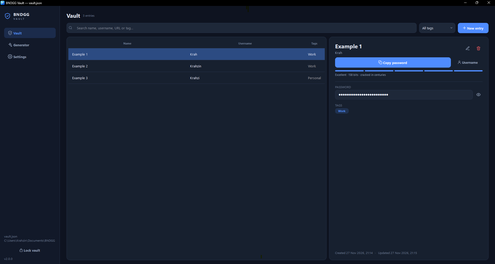

# BNDGG Vault

A local-first, zero-knowledge password manager for Windows, built with Python and
PySide6. No cloud, no telemetry, no network access — one encrypted file that you
choose the location of.



## Highlights

- **Argon2id + AES-256-GCM.** Memory-hard key derivation, authenticated encryption.
  The header is authenticated too, so KDF downgrades and salt swaps are detected.
- **You choose the vault file.** No hidden AppData writes. Create the vault wherever
  you like, move it later from Settings.
- **Six themes.** Midnight, Graphite, Nord, Forest, Porcelain and Sand — switch live.
- **Real entry model.** Service, username, password, URL, tags, notes, TOTP secret,
  created/updated timestamps and password history.
- **Built-in TOTP.** Store a 2FA secret and read the live code in the app.
- **Password health.** Strength meter with entropy and crack-time estimates, plus
  weak / reused / stale counts in Settings.
- **Safe by default.** Atomic writes with a `.bak` of the previous version,
  configurable auto-lock, clipboard auto-clear, auto-hide for revealed passwords.
- **Password + passphrase generator.** Guarantees one character from every enabled
  class; 500+ word passphrase vocabulary.
- **Import/export.** Encrypted vault copies, CSV export (with a warning), and a
  one-time importer for legacy v1 vaults.

## Install

```powershell
git clone https://github.com/Krahzin/BNDGG-Vault.git
cd BNDGG-Vault
python -m venv .venv
.\.venv\Scripts\python -m pip install -r app\requirements.txt
.\.venv\Scripts\python app\main.py
```

Requires Python 3.10+ (tested on 3.15) and Windows 10/11.

## Build a standalone exe

```powershell
.\app\build.bat
```

The result is `dist\BNDGG-Vault.exe` (single file, no console).

> **SmartScreen:** the binary is not code-signed, so Windows may warn on first run.
> Click **More info → Run anyway**.

## Vault file format

```json
{
  "format": "bndgg-vault",
  "version": 2,
  "cipher": "AES-256-GCM",
  "kdf": { "algo": "argon2id", "time_cost": 3, "memory_cost": 65536,
           "parallelism": 4, "salt": "<base64>" },
  "nonce": "<base64>",
  "payload": "<base64 ciphertext + tag>",
  "created": "…",
  "modified": "…"
}
```

Only the nonce and ciphertext sit outside the authentication tag; everything else is
AAD. Entries are never written unencrypted, and saves are atomic
(`vault.json.tmp` → `os.replace`) with the previous version kept as `vault.json.bak`.

## Migrating from v1

v1 vaults (Fernet, `vault_blob`, no header) are not opened directly. Create a new v2
vault, then use **Settings → Vault → Import legacy v1…** with the old master password.
The old file is left untouched.

## Project layout

```
app/                     application source, tests and build files
  main.py                entry point
  bndgg/core/crypto.py   Argon2id + AES-256-GCM envelope
  bndgg/core/vault.py    entries, atomic persistence, import/export
  bndgg/core/generator.py  password / passphrase generation
  bndgg/core/strength.py   offline strength estimation
  bndgg/core/totp.py       RFC 6238 codes
  bndgg/core/settings.py   QSettings-backed preferences
  bndgg/ui/themes.py     palettes + generated Qt stylesheet
  bndgg/ui/main_window.py  shell, navigation, idle lock, clipboard
  bndgg/ui/*_view.py     vault, generator, settings, unlock screens
  tests/                 core + offscreen UI test suite
project/                 icon, LICENSE, README, screenshot, legacy_v1/
vaults/                  your encrypted vault files (gitignored)
```

Run the tests with:

```powershell
.\.venv\Scripts\python -m unittest discover -s app\tests -v
```

## Security notes

- The master password is never stored; losing it means losing the vault.
- The vault is decrypted into process memory while unlocked. That is inherent to a
  local password manager — lock the vault when you step away (Ctrl+L).
- Clipboard contents are cleared after a configurable delay, but other apps can read
  the clipboard while the secret is there.
- This is a personal project, not an audited product. Review the code before trusting
  it with anything critical.

## License

MIT — see [LICENSE](LICENSE).
